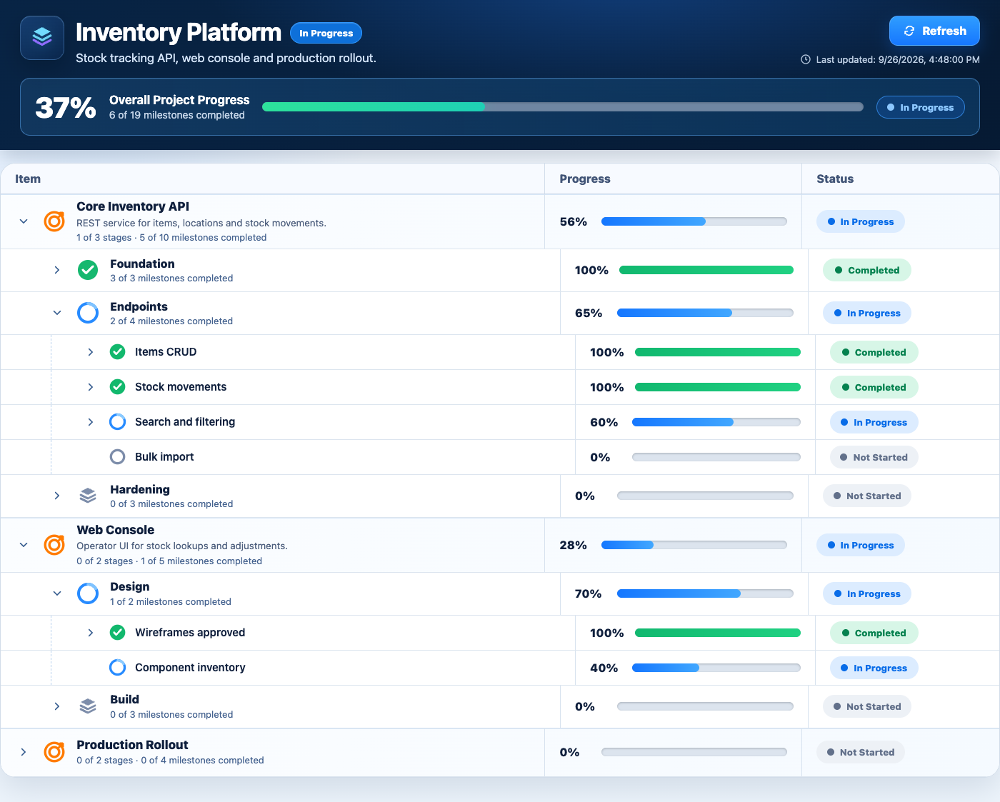

# project-status-board

A portable [Agent Skill](https://agentskills.io) that gives any long-running, AI-assisted project a clear visual status dashboard. Your coding agent keeps it in sync as it works.

It works with **Claude Code**, **Gemini CLI** and **OpenAI Codex** from one `SKILL.md`.



## What it does

- Models your project as **Goals → Stages → Milestones**.
- On first use, the agent reads your plan (README, docs, TODOs, AGENTS.md / CLAUDE.md / GEMINI.md, git history, what you told it). It then builds the hierarchy and sets progress from real evidence.
- As work progresses, the agent updates the status file at meaningful checkpoints, not on every edit.
- The dashboard is one static HTML page. It uses no framework, build step, dependencies, network calls or telemetry.
- It shows overall, goal, stage and milestone progress, with **Completed** (green), **In Progress** (blue) and **Not Started** (gray) status.
- Goals and stages collapse and expand. The active goal and stage open automatically. Future and finished work stays collapsed.
- A **Refresh** button re-reads the data, and optional auto-refresh is available.

## How it works

Initializing creates one folder in your project:

```text
your-project/
└── project-status/
    ├── index.html            # reusable dashboard (never project-specific)
    └── project-status.json   # the only file the agent maintains
```

Only milestones store progress. Everything else is calculated:

| Level | Progress |
|---|---|
| Milestone | `progress` in the JSON (0–100) |
| Stage | average of its milestones |
| Goal | average of all milestones in the goal |
| Project | average of all milestones in the project |

A status of `0` is Not Started, `1–99` is In Progress and `100` is Completed. The percentages shown never round up to a false 100% or down to a false 0%.

## Installation

The skill itself is the folder [`skills/project-status-board/`](skills/project-status-board). The rest of this repository is docs, tests and packaging.

### Local development (one copy, linked everywhere)

```bash
git clone https://github.com/EasyTechWithHassan/project-status-board-skill.git
cd project-status-board-skill
./install.sh              # ./install.sh --uninstall to remove
```

`install.sh` creates two symlinks to the same folder, so edits take effect immediately:

| Link | Read by |
|---|---|
| `~/.claude/skills/project-status-board` | Claude Code |
| `~/.agents/skills/project-status-board` | Gemini CLI and Codex (the shared Agent Skills folder) |

On Windows, copy or junction `skills/project-status-board` into the same two folders under `%USERPROFILE%`.

### Claude Code

Install as a plugin straight from GitHub:

```text
/plugin marketplace add EasyTechWithHassan/project-status-board-skill
/plugin install project-status-board@project-status-board-skill
```

Or use it as a plain skill by linking or copying `skills/project-status-board` to `~/.claude/skills/project-status-board` (all projects) or `.claude/skills/project-status-board` (one project).

### Gemini CLI

```bash
gemini skills install https://github.com/EasyTechWithHassan/project-status-board-skill.git --path skills/project-status-board
```

Or link a local clone: `gemini skills link ./skills/project-status-board`. Don't combine this with `install.sh`, which already covers Gemini through `~/.agents/skills`. Doing both lists the skill twice. Check with `gemini skills list`.

### Codex

Codex reads `~/.agents/skills` (user) and `.agents/skills` (repo):

```bash
git clone https://github.com/EasyTechWithHassan/project-status-board-skill.git ~/src/project-status-board-skill
mkdir -p ~/.agents/skills
ln -s ~/src/project-status-board-skill/skills/project-status-board ~/.agents/skills/project-status-board
```

You can also ask Codex's built-in `$skill-installer` to install the folder URL `https://github.com/EasyTechWithHassan/project-status-board-skill/tree/main/skills/project-status-board`. Restart Codex after installing.

A ZIP of the skill folder is attached to each [release](https://github.com/EasyTechWithHassan/project-status-board-skill/releases). Unzip it into any of the folders above.

## Using it

Ask your agent, in any of the three tools:

> Use the project-status-board skill for this project. Initialize the dashboard from the current project plan and keep it updated as you work.

In Claude Code you can also type `/project-status-board`, and in Codex `$project-status-board`. The skill also activates on its own when a project already has `project-status/project-status.json`.

To view the dashboard, run this from the project root:

```bash
python3 -m http.server 8765 --bind 127.0.0.1 --directory project-status
```

Then open http://127.0.0.1:8765/. You need the server because browsers block reading local JSON from `file://` pages.

To have every future session keep the board current, add one line to the project's `AGENTS.md`, `CLAUDE.md` or `GEMINI.md`:

```text
Keep project-status/project-status.json current using the project-status-board skill.
```

## How agents maintain the dashboard

- Update on **meaningful** changes: a milestone starts, moves meaningfully or completes, or the plan changes.
- Never mark work complete without evidence (merged code, passing tests, a delivered artifact). Record that evidence on the milestone.
- Keep IDs stable, never wipe existing status, and bump `project.updatedAt` on every change.
- Use the bundled scripts (Python 3, standard library only):

| Script | Purpose |
|---|---|
| `scripts/init_dashboard.py` | Creates `project-status/`. Never overwrites an existing JSON file. `--upgrade-html` refreshes the page and backs up the old one. |
| `scripts/validate_status.py` | Reports malformed JSON (line and column), missing fields, duplicate IDs, bad progress, empty goals or stages and more, then prints a progress tree. |
| `scripts/set_progress.py` | `set_progress.py api-auth=100 --evidence "PR #42"` validates before writing and bumps `updatedAt`. |

## Example `project-status.json`

```json
{
  "schemaVersion": 1,
  "project": {
    "name": "Inventory Platform",
    "subtitle": "Stock tracking API, web console and production rollout.",
    "updatedAt": "2026-09-26T16:48:00-07:00",
    "autoRefreshSeconds": 0
  },
  "goals": [
    {
      "id": "api",
      "name": "Core Inventory API",
      "description": "REST service for items, locations and stock movements.",
      "stages": [
        {
          "id": "api-foundation",
          "name": "Foundation",
          "milestones": [
            { "id": "api-schema", "name": "Database schema", "progress": 100,
              "evidence": "migrations 001-004; tests/test_schema.py passes" },
            { "id": "api-auth", "name": "Auth middleware", "progress": 40 }
          ]
        }
      ]
    }
  ]
}
```

The full schema is in [`references/data-schema.md`](skills/project-status-board/references/data-schema.md). A larger sample is in [`examples/demo/`](examples/demo/project-status.json). To try it:

```bash
python3 skills/project-status-board/scripts/validate_status.py examples/demo
python3 -m http.server 8765 --bind 127.0.0.1
# then open http://127.0.0.1:8765/skills/project-status-board/assets/index.html?data=/examples/demo/project-status.json
```

## Repository layout

```text
project-status-board-skill/
├── skills/project-status-board/       # ← the portable skill
│   ├── SKILL.md                       # core workflow (frontmatter + instructions)
│   ├── assets/
│   │   ├── index.html                 # dashboard (HTML + CSS + vanilla JS, inline SVG)
│   │   └── project-status.template.json
│   ├── references/
│   │   ├── data-schema.md             # JSON schema and calculation rules
│   │   └── usage.md                   # structuring, update policy, troubleshooting
│   └── scripts/
│       ├── init_dashboard.py
│       ├── validate_status.py
│       └── set_progress.py
├── .claude-plugin/                    # thin Claude Code plugin/marketplace wrapper
├── install.sh                         # symlink the skill for local development
├── examples/demo/project-status.json
├── tests/                             # unittest suite (+ optional Playwright browser tests)
├── docs/screenshot.png
└── LICENSE
```

## Development

```bash
python3 -m unittest discover -s tests -v          # scripts, schema and SKILL.md checks
uv venv .venv && uv pip install playwright         # optional: browser tests use local Chrome
.venv/bin/python -m unittest discover -s tests -v
```

## License

[MIT](LICENSE)
